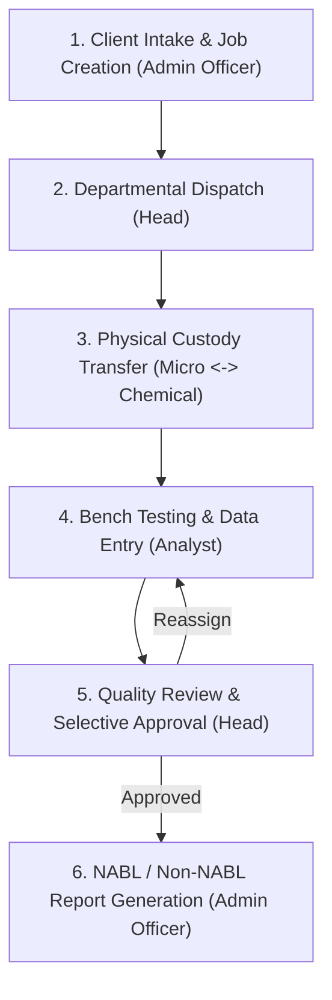

# Acropolis FTL LIMS

> Laboratory Information Management System for the Food Testing Laboratory at Acropolis Institute of Pharmaceutical Education and Research (AIPER).

---

## 1. Overview

Acropolis FTL LIMS is a dedicated, full-stack Laboratory Information Management System built to digitize, streamline, and audit the complete sample testing lifecycle at the Food Testing Laboratory of the Acropolis Institute of Pharmaceutical Education and Research (AIPER).

Testing laboratories handle strict regulatory mandates, complex testing taxonomies across microbiology and chemistry, and multi-step approval gates. Before this system, operations relied on manual paper registers, static spreadsheets, and informal coordination. This LIMS replaces that fragmented workflow with a centralized, real-time platform that governs sample intake, custody transfer, parameter assignment, analytical data entry, multi-level review, and the automated generation of NABL-compliant test reports.

---

## 2. The Sample Testing Lifecycle

The core workflow transitions a client sample through a chain of custody and verification:



1. **Client Intake & Job Registration**: An Admin Officer records customer details, sample characteristics, regulatory scope (NABL, Non-NABL, or Hybrid), and selects required test parameters from a hierarchical catalogue.
2. **Departmental Dispatch**: Department Heads (Microbiology and Chemical Analysis) receive notifications for assigned parameters, delegate specific parameters to qualified analysts, and set deadlines.
3. **Chain of Custody & Sample Transfer**: When samples require testing across both departments, the system tracks physical handovers with formal dispatch and receipt confirmations.
4. **Laboratory Testing**: Analysts access a mobile-ready bench interface on tablets or desktops, record physical observations, enter measurement values, and select standardized test methods.
5. **Quality Review**: Department Heads inspect submitted results against standard specifications. Heads can approve submissions or selectively reassign specific failed parameters for re-testing without discarding valid work.
6. **Report Delivery**: Once all departmental tests are approved, the system generates formatted, compliance-ready test reports complete with sequential ULR tracking, QR codes, and digital signatures.

---

## 3. User Roles & Responsibilities

The system enforces strict role-based access control (RBAC), providing each laboratory role with a dedicated dashboard and isolated capabilities:

| Role | Operational Scope | Primary Responsibilities |
|---|---|---|
| **System Administrator** | System-wide | Manages user accounts, configures system settings, monitors lab throughput, and inspects the immutable audit log. |
| **Admin Officer** | Front Office & Registration | Handles client intake, creates and edits jobs, configures test parameters, monitors overall sample progress, and issues completed test reports. |
| **Department Head** | Microbiology / Chemical Analysis | Distributes incoming test parameters to analysts, manages physical sample transfers between departments, conducts quality reviews, and approves or reassigns test results. |
| **Analyst (Assistant)** | Bench Laboratory | Conducts laboratory testing, logs physical sample observations, enters analytical results and test methods, and submits completed test runs for review. |

---

## 4. Key Platform Features

### Cascading Parameter Engine
Food and water testing involves hundreds of distinct parameters with specific units, test methods, and regulatory limits. The system organizes testing taxonomy into hierarchical groups and sub-groups (e.g., Water -> Drinking Water -> Total Coliform). A typo-tolerant fuzzy search engine allows staff to quickly locate and attach parameters, while specialized panels (such as pesticide screening) can be attached with a single click.

### Multi-Tier Accreditation Modes
Jobs can be registered under three distinct operational modes:
- **Non-NABL**: Standard laboratory testing reports.
- **NABL**: Accreditation-grade jobs with automatic assignment and sequential tracking of Unique Lab Report (ULR) numbers.
- **Hybrid**: Simultaneously spawns linked NABL and Non-NABL sub-jobs from a single client submission, allowing split parameters without double-entry.

### Inter-Departmental Custody Tracking
Samples requiring both microbiological and chemical analysis must follow strict physical custody protocols. The system prevents concurrent testing conflicts by tracking outgoing and incoming transfers, requiring explicit confirmation of sample receipt before downstream testing can commence.

### Selective Reassignment & Quality Gates
If a review indicates an anomalous reading on one parameter out of twenty, Department Heads do not need to reject the entire batch. The review interface allows selective reassignment of only the affected parameters with specific feedback notes, preserving approved data and minimizing turnaround time.

### Automated Document Generation & In-Browser Preview
The system builds structured test reports natively, calculating exact layouts, table dimensions, NABL formatting requirements, dynamic QR codes, and signature blocks. Staff can preview full reports directly in the browser before final delivery or export.

### Real-Time WebSocket Synchronization
All job queues, task dispatches, sample transfers, and approval states update instantly across all active sessions using persistent WebSockets, eliminating the need for manual browser refreshes.

### Immutable Audit Trail
Every significant operational event (job creation, parameter modification, status change, re-assignment, user authentication) is permanently recorded in a structured system log. Logs capture timestamps, user context, target identifiers, and modification diffs for compliance auditing.

---

## 5. Technology Stack

### Frontend
- **Framework:** React 19, Vite 8
- **Routing:** React Router v7
- **Styling & UI:** CSS Variables, Lucide React Icons
- **Real-Time Client:** Socket.IO Client
- **Search:** Fuse.js (fuzzy matching)
- **Document Rendering:** docx-preview, html2pdf.js

### Backend
- **Runtime:** Node.js, Express 5
- **Database ODM:** Mongoose v9
- **Real-Time Server:** Socket.IO
- **Security & Headers:** Helmet, CORS, Express Rate Limit, JWT, bcrypt
- **Logging:** Winston with MongoDB transport
- **Document Engine:** Programmatic docx generation with XML and GridFS streaming

### Database & Storage
- **Primary Database:** MongoDB
- **Binary Storage:** MongoDB GridFS (for accreditation logos, signatures, and custom report files)

---

## 6. Project Architecture

```
AIPER/
├── backend/
│   ├── config/              # Database connection and environment setup
│   ├── middlewares/         # Authentication, role verification, rate limiting, logging
│   ├── models/              # Mongoose schemas (Job, TestInstance, User, SystemLog, etc.)
│   ├── routes/
│   │   ├── authRoutes.js    # Login, password updates, and session verification
│   │   ├── jobs/            # Job creation, listing, workflows, and re-testing
│   │   ├── tests/           # Test instance assignment, result entry, and reviews
│   │   └── ...              # Logs, notifications, settings, and file uploads
│   ├── utils/               # Serial generators, audit logger, document builder, notifier
│   └── server.js            # Express server entry point and WebSocket initialization
│
├── frontend/
│   ├── src/
│   │   ├── components/      # Shared UI elements (PageHeader, modals, tables, layout)
│   │   ├── context/         # AuthContext, SocketContext, ModalContext, ToastContext
│   │   ├── hooks/           # Custom hooks (useListControls, useToast, useModal)
│   │   ├── pages/
│   │   │   ├── AdminDashboard.jsx            # Admin oversight and user management
│   │   │   ├── AdminOfficer/JobsPage.jsx     # Job creation, registration, and job logs
│   │   │   ├── Head/                         # Dispatcher, review queue, and monitor pages
│   │   │   └── AssistantDashboard.jsx        # Mobile-ready bench testing and data entry
│   │   └── utils/           # API client, date formatting, and caching logic
│   ├── e2e/                 # Playwright end-to-end test suites
│   └── vite.config.js       # Vite configuration and build pipeline
│
└── .agents/                 # Architecture specifications and development plans
```

---